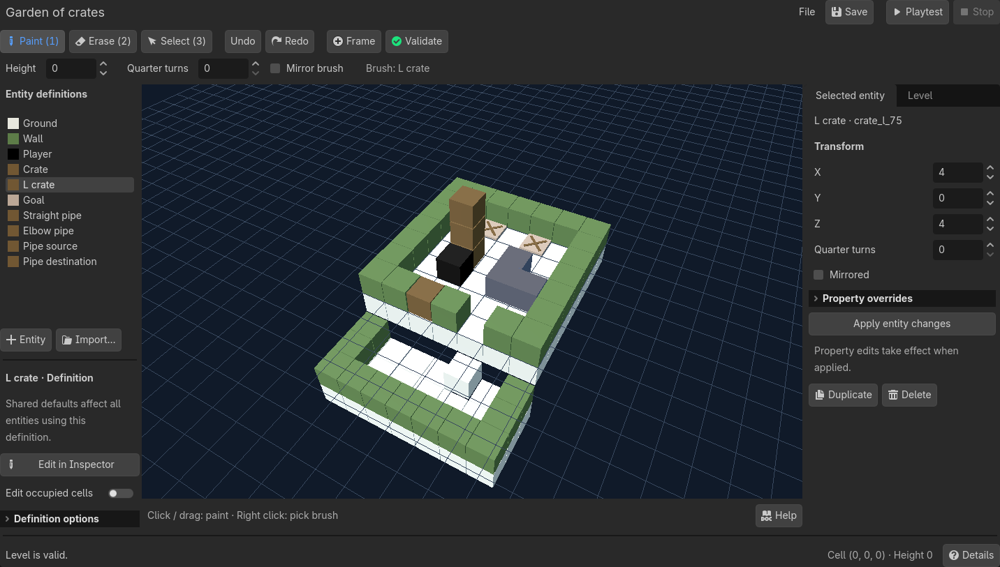

# Grid Game Groundwork for Godot

**English** | [简体中文](README.zh-CN.md)

A Godot addon for making 3D grid puzzles. Paint levels, playtest, and extend mechanics with GDScript. Includes Sokoban, pipes, and QUACK!!! on ICE.

**Godot Standard · Compatibility renderer**. The project declares Godot 4.7; the documented test version is 4.7.2.

## Quick start

1. Import `project.godot` in Godot and open **Grid Levels** in the top toolbar. If missing, enable **Grid Game Groundwork** in **Project → Project Settings → Plugins**.
2. Click **File → Open…** and choose `examples/levels/sokoban.tres`, `pipes.tres`, or `quack.tres`.
3. Choose an entity from the palette. Use **1 / 2 / 3** to paint, erase, or select. Drag the selection's axis or plane handles to move by whole cells; **End** snaps a single selected entity down to support.
4. Click **Save**, then **Playtest**. Click **Stop** to return to editing. Play never changes your authored level; unsaved edits still need saving.

To play directly, run the project for Sokoban, or open `examples/pipes.tscn` / `examples/quack.tscn` and run the current scene. In Sokoban, press **S twice** from the start to push a crate onto the lower landing.

The editor keeps painting tools visible, groups shared definitions on the left, and separates selected-entity properties from level settings on the right. Tool hints and operation results stay close to the canvas.

## Features

| Area | Included |
| --- | --- |
| Level editing | New/open/save/save as `.tres`; remembered last saved level; unsaved-change prompts; validation; isolated playtest and stop. |
| Painting | Drag paint/erase, surface snapping, automatic stacking, height plane, brush rotation/mirroring, eyedropper, rectangular ground fill. |
| Selection | Shift-click multi-selection; XYZ and XY/XZ/YZ movement handles; whole-cell snapping; single-entity End snap; duplicate/delete groups; invalid-move feedback and cancellation. |
| Entities | Reusable definitions; create/import/save assets; Inspector defaults; per-entity typed overrides; visual 3D occupied-cell editing; custom visual scenes. |
| Presentation | Blue selection and red erase feedback on model surfaces, occlusion and transparency-aware picking; orbit/pan/zoom/frame; free camera flight and adjustable speed. |
| Level tools | Title, gravity and fall-out settings; game-rule picker; rotate/mirror the whole level; authoring undo/redo. |
| Gameplay | Cardinal XZ movement, multi-cell shapes, explicit ground, rigid overhangs, stacking, gravity, fall-out and chain pushing; permission and strength/weight push presets. |
| History and input | Complete-action undo/redo, undoable restart, recovery after success/failure, click to switch actors, staged animation and buffered rapid input. |
| Extension and export | Custom movement, interactions, obstacles, win conditions and visuals; completion/failure signals; Linux and single-threaded Web export presets. |

The [designer guide](docs/designer-guide.md) explains each editing feature and its limits. The [extension guide](docs/extending.md) covers programming interfaces.

## Essential controls

| Context | Controls |
| --- | --- |
| Editor | **1 / 2 / 3**: Paint / Erase / Select · **Shift+click**: toggle selection · **Delete**: delete selection · **End**: snap one entity down · **Esc**: cancel a move |
| Editor camera | **WASD**: fly · **Q/E**: down/up · right drag: look · right+wheel: speed · **Page Up/Down**: placement height |
| Editor history | **Ctrl/Cmd+S**: save · **Ctrl/Cmd+Z**: undo · **Ctrl/Cmd+Shift+Z** or **Ctrl/Cmd+Y**: redo |
| Play | **WASD / arrows**: move · click: select actor · **Z / Y / R**: undo / redo / restart |
| Camera, editor or play | Middle drag: orbit · **Shift+middle drag**: pan · wheel: zoom · **F**: frame |

Click the viewport/game to focus it. Editing shortcuts leave text and property inputs alone. See the [full shortcut reference](docs/designer-guide.md#shortcut-reference), including shape editing and navigation behavior.

## Examples

| Example | What to try |
| --- | --- |
| [Sokoban](examples/sokoban.tscn) | Push ordinary and L-shaped crates, including chains, onto all goals; use elevated platforms and undo falls. |
| [Pipes](examples/pipes.tscn) | Push straight and elbow pipes to connect every destination to a source through matching ports; connected pipes light up. |
| [QUACK!!! on ICE](examples/quack.tscn) | Click between three ducks, slide to eat bread, drop between platforms and use fed ducks as stoppers. [Rules and seven-move walkthrough](docs/quack-example.md). |

## Use in your project

Copy `addons/grid_game_groundwork/` into your project's `addons/` folder and enable the plugin. Attach `addons/grid_game_groundwork/runtime/game.gd` to a `Node3D`, assign a **Level**, and run the scene. Example rules, visuals and assets live separately under `examples/`; copy the dependencies of any example content you reuse.

The addon handles individual levels. Campaign menus, unlocking, persistent progression, in-game level editors, community sharing and Unity level import are outside the current scope.

## Documentation

- [Designer guide](docs/designer-guide.md) · [中文用户指南](docs/designer-guide.zh-CN.md)
- [Extension guide](docs/extending.md) — rules, visuals and runtime integration.
- [Development](docs/development.md) — checks, export and example regeneration.
- [Editor surface coverage](docs/editor-surface-coverage.md) — custom-material support and limits.
- [Domain language](CONTEXT.md) · [Design decisions](docs/adr/)

Inspired by Corey Martin's [Grid Game Groundwork for Unity](https://github.com/corey-martin/grid-game-groundwork). QUACK is based on [QUACK!!! on ICE](https://akacmd.itch.io/quack-on-ice) ([source](https://github.com/AkaCMD/Bevy_Jam_4)). See [third-party notices](THIRD_PARTY_NOTICES.md).
