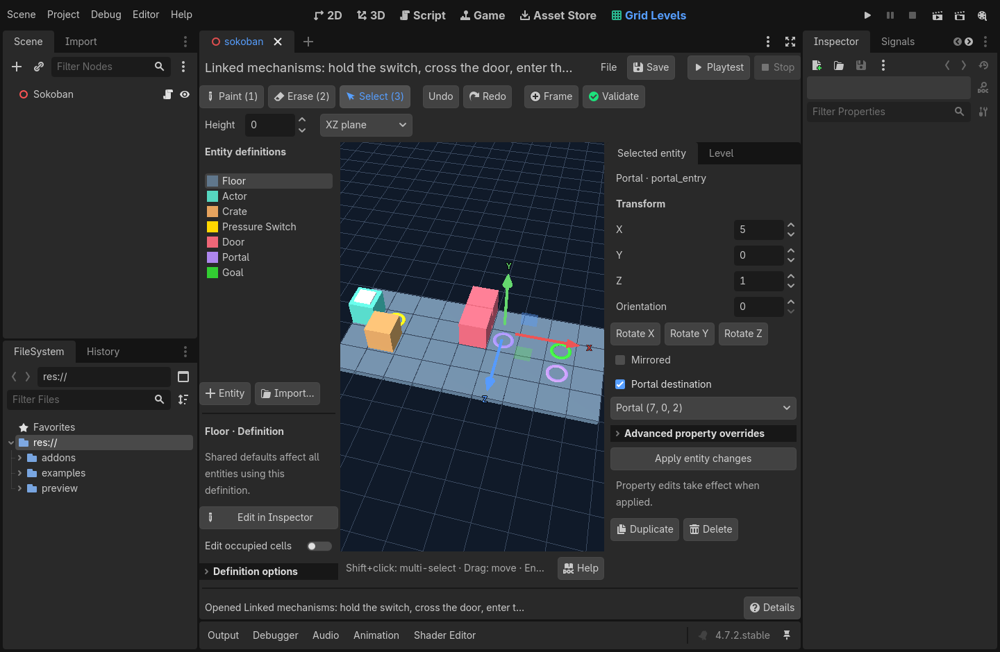
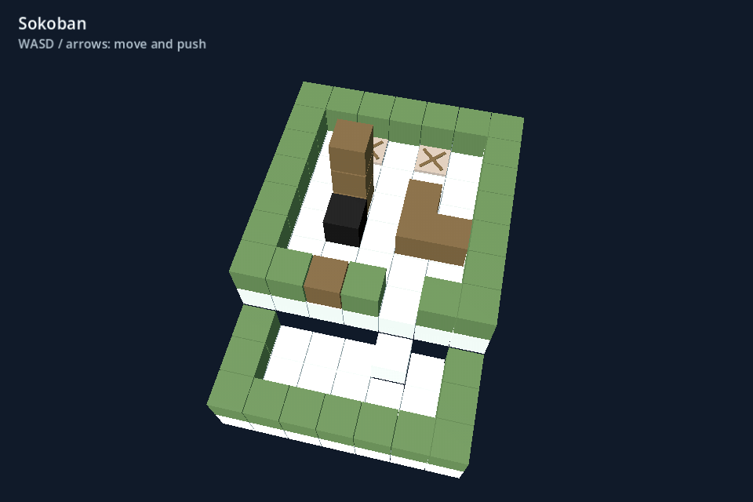
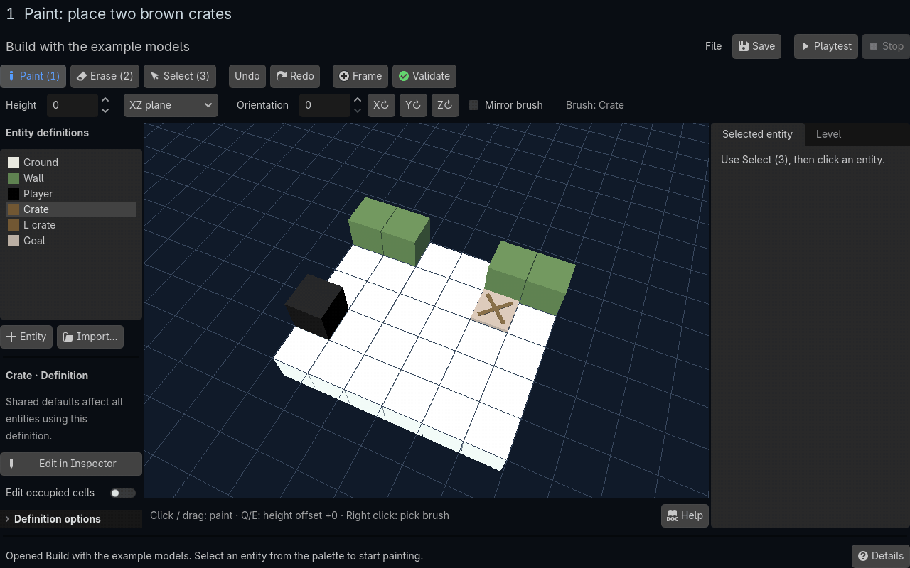
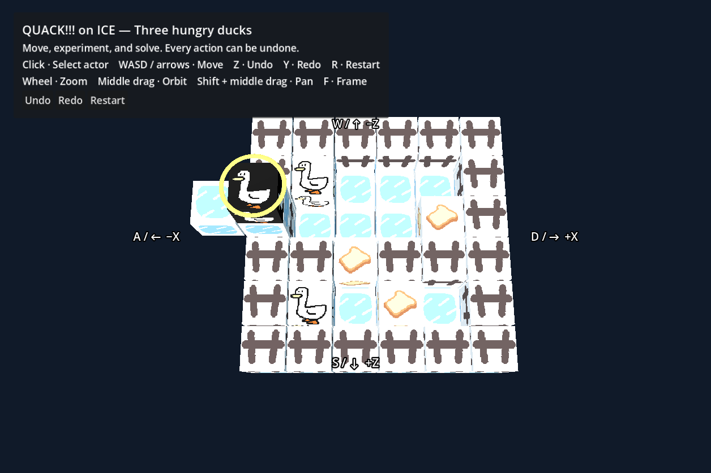

# Grid Game Groundwork for Godot

**English** | [简体中文](README.zh-CN.md)

A Godot addon for making 3D grid puzzles. Paint levels, playtest, and extend mechanics with GDScript. Includes Sokoban, pipes, QUACK!!! on ICE, rolling blocks, changing gravity and linked mechanisms.

Use **Godot Standard** with the **Compatibility renderer**. The [project configuration](project.godot) declares Godot 4.7; see [development checks](docs/development.md#checks) for the test setup.

## Quick start

1. Import `project.godot` in Godot and wait for the import to finish.
2. Open **Grid Levels** in the top toolbar. If it is missing, enable **Grid Game Groundwork** in **Project → Project Settings → Plugins**.
3. Choose **File → Open…** and open `examples/levels/sokoban.tres`.
4. Choose **Crate** in the left palette, select **Paint (1)**, and click the ground to place a crate. Use **Select (3)** to select it and drag a movement handle.
5. Choose **File → Save as…** to save your layout to a new `.tres` file in the project.
6. Click **Playtest**, then use **WASD / arrows** to move and **Z** to undo. Click **Stop** to return to editing.

Playtest includes unsaved edits without changing the authored level. **Save as…** copies the layout but keeps references to shared definitions and rules. Read [saving and shared resources](docs/designer-guide.md#definitions-overrides-and-shapes) before changing their defaults.

To play directly, run the project for Sokoban, or open `examples/pipes.tscn` / `examples/quack.tscn` and run the current scene. In Sokoban, press **S twice** from the start to push a crate onto the lower landing.

## Features

| Area | Included |
| --- | --- |
| Authoring | Paint, erase, move groups, edit occupied cells, validate and save native `.tres` levels. |
| Entities | Shared definitions, named fields, entity references, per-entity overrides and custom visual scenes. |
| Gameplay | 24 orthogonal orientations, configurable rules and complete-action undo/redo. |
| Integration | Custom rules and visuals, completion/failure signals, Linux and Web export presets. |

## Essential controls

| Context | Controls |
| --- | --- |
| Editor | **1 / 2 / 3**: Paint / Erase / Select · **Shift+click**: toggle selection · **Delete**: delete selection · **End**: snap one entity down · **Esc**: cancel a move |
| Editor height | **Q/E**: lower/raise the Paint preview or the selected entities in Select · **Page Up/Down**: placement plane |
| Editor camera | **WASD**: fly · right+**Q/E**: down/up · right drag: look · right+wheel: speed |
| Editor history | **Ctrl/Cmd+S**: save · **Ctrl/Cmd+Z**: undo · **Ctrl/Cmd+Shift+Z** or **Ctrl/Cmd+Y**: redo |
| Play | **WASD / arrows**: move · click: select actor · **Z / Y / R**: undo / redo / restart |
| Camera, editor or play | Middle drag: orbit · **Shift+middle drag**: pan · wheel: zoom · **F**: frame |

Click the viewport/game to focus it. Editing shortcuts leave text and property inputs alone. See the [full shortcut reference](docs/designer-guide.md#shortcut-reference), including shape editing and navigation behavior.

## Examples

| Example | What to try |
| --- | --- |
| [Sokoban](examples/sokoban.tscn) | Push ordinary and L-shaped crates, including chains, onto all goals; use elevated platforms and undo falls. |
| [Pipes](examples/pipes.tscn) | Push straight and elbow pipes to connect every destination to a source through matching ports; connected pipes light up. |
| [Rolling block](examples/rolling.tscn) | Press **D twice** to roll the marked block onto its goal with the required face down. |
| [Changing gravity](examples/gravity.tscn) | **1-6** select down/up/left/right/forward/back; **0** turns gravity off. **Q/E** moves along Y. |
| [Linked mechanisms](examples/links.tscn) | Hold a pressure switch with a crate, cross an open door, and enter a directed portal. [Walkthrough](docs/designer-guide.md#additional-rule-examples). |
| [QUACK!!! on ICE](examples/quack.tscn) | Click between three ducks, slide to eat bread, drop between platforms and use fed ducks as stoppers. [Rules and seven-move walkthrough](docs/quack-example.md). |

## Use in your project

Copy `addons/grid_game_groundwork/` into your project's `addons/` folder and enable the plugin. Attach `addons/grid_game_groundwork/runtime/game.gd` to a `Node3D`, assign a **Level**, and run the scene. Example rules, visuals and assets live separately under `examples/`; copy the dependencies of any example content you reuse.

The addon handles individual levels. Campaign menus, unlocking, persistent progression, in-game level editors, community sharing and Unity level import are outside the current scope.

## Documentation

- [Designer guide](docs/designer-guide.md) · [中文用户指南](docs/designer-guide.zh-CN.md)
- [Extension guide](docs/extending.md) · [中文扩展指南](docs/extending.zh-CN.md): rules, visuals and runtime integration.
- [Development](docs/development.md) · [中文开发说明](docs/development.zh-CN.md): checks, export and example regeneration.
- [QUACK example](docs/quack-example.md) · [中文示例说明](docs/quack-example.zh-CN.md): rules and a walkthrough.
- [Domain language](CONTEXT.md) · [中文术语](CONTEXT.zh-CN.md): shared concepts; [rule extensibility decision](docs/adr/0010-share-authoring-across-game-rules.md).
- [Editor surface coverage](docs/editor-surface-coverage.md) · [中文材质支持说明](docs/editor-surface-coverage.zh-CN.md): custom-material support and limits.

Inspired by Corey Martin's [Grid Game Groundwork for Unity](https://github.com/corey-martin/grid-game-groundwork). QUACK is based on [QUACK!!! on ICE](https://akacmd.itch.io/quack-on-ice) ([source](https://github.com/AkaCMD/Bevy_Jam_4)). See [third-party notices](THIRD_PARTY_NOTICES.md).
