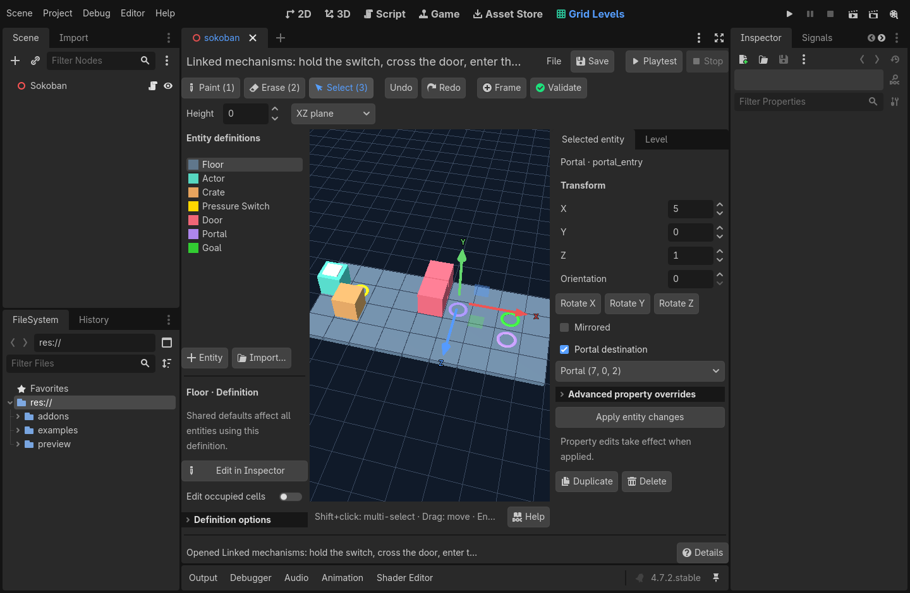
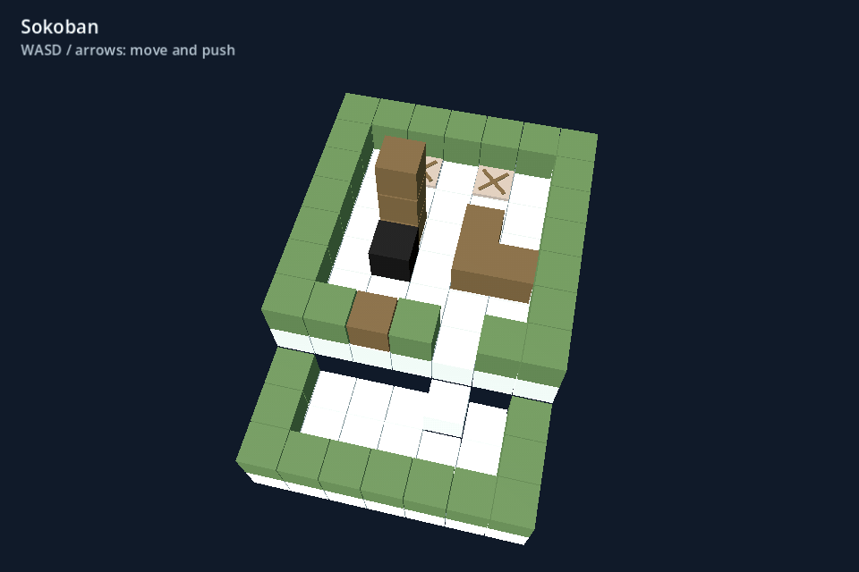
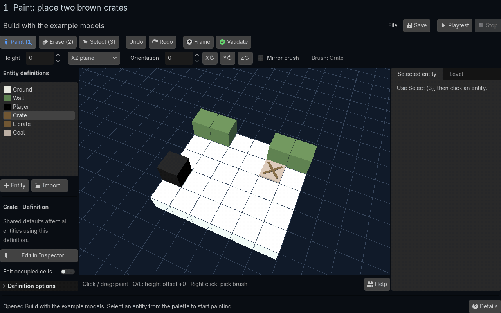
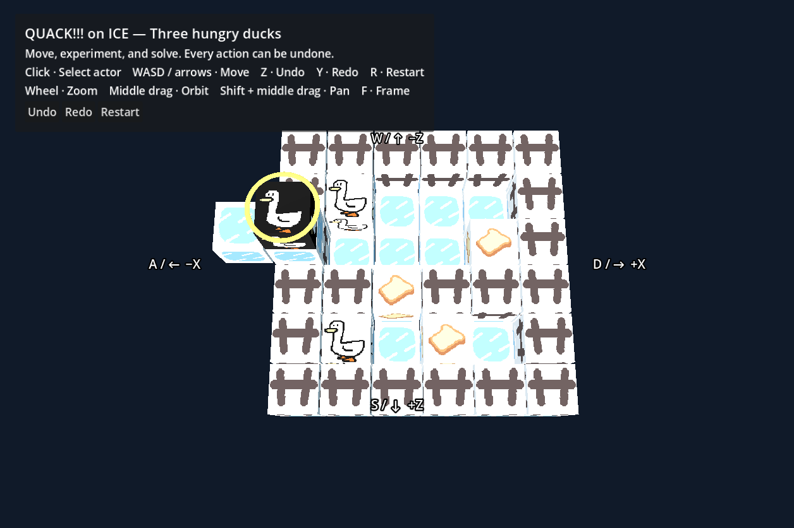

# Grid Game Groundwork for Godot

[English](README.md) | **简体中文**

用于制作 3D 网格解谜游戏的 Godot 插件。可视化绘制关卡、试玩，并用 GDScript 扩展玩法。附带推箱子、管道、QUACK!!! on ICE、翻滚方块、重力切换和关联机关六个示例。

使用 **Godot 标准版**和 **Compatibility 渲染器**。[项目配置](project.godot)声明使用 Godot 4.7，测试环境见[开发检查](docs/development.zh-CN.md#检查)。

## 快速开始

1. 在 Godot 中导入 `project.godot`，等待导入完成。
2. 打开顶部的 **Grid Levels**。若未显示，在 **项目 → 项目设置 → 插件**中启用 **Grid Game Groundwork**。
3. 点击 **File → Open…**，打开 `examples/levels/sokoban.tres`。
4. 在左侧选择 **Crate**，使用 **Paint (1)** 点击地面放置箱子。切换 **Select (3)**，选中箱子并拖动移动手柄。
5. 通过 **File → Save as…** 将布局另存为项目中的新 `.tres` 文件。
6. 点击 **Playtest**，使用 **WASD／方向键**移动，按 **Z** 撤销。点击 **Stop** 返回编辑。

试玩包含未保存的编辑，不会改变设计好的关卡。**Save as…** 复制布局，但保留对共享定义与规则的引用。修改默认值前，请先阅读[保存与共享资源说明](docs/designer-guide.zh-CN.md#实体定义属性覆盖与形状)。

直接运行项目可玩推箱子；打开 `examples/pipes.tscn` 或 `examples/quack.tscn` 后运行当前场景可玩其他示例。推箱子开局按两次 **S**，可将箱子推落到下层平台。

## 功能一览

| 类别 | 功能 |
| --- | --- |
| 关卡编辑 | 绘制、擦除、整组移动、占格编辑、校验与原生 `.tres` 保存。 |
| 实体 | 共享定义、具名字段、实体引用、单实体属性覆盖与自定义外观场景。 |
| 玩法 | 24 种正交朝向、可配置规则与完整动作撤销／重做。 |
| 接入 | 自定义规则与外观、完成／失败信号、Linux 和 Web 导出预设。 |

## 常用操作

| 场景 | 操作 |
| --- | --- |
| 编辑 | **1 / 2 / 3**：绘制／擦除／选择 · **Shift+点击**：增减选择 · **Delete**：删除所选 · **End**：单实体向下贴地 · **Esc**：取消移动 |
| 编辑高度 | **Q/E**：降低／抬升 Paint 预览或 Select 中的选中实体 · **Page Up/Down**：放置平面 |
| 编辑摄像机 | **WASD**：飞行 · 右键+**Q/E**：下降／上升 · 右键拖动：转向 · 右键+滚轮：速度 |
| 编辑历史 | **Ctrl/Cmd+S**：保存 · **Ctrl/Cmd+Z**：撤销 · **Ctrl/Cmd+Shift+Z** 或 **Ctrl/Cmd+Y**：重做 |
| 游玩 | **WASD／方向键**：移动 · 点击：选角色 · **Z / Y / R**：撤销／重做／重开 |
| 编辑与游玩摄像机 | 中键拖动：环绕 · **Shift+中键拖动**：平移 · 滚轮：缩放 · **F**：完整取景 |

先点击视口或游戏窗口获取焦点。编辑快捷键不会干扰文本或属性输入。形状编辑和导航细节见 [完整操作表](docs/designer-guide.zh-CN.md#操作速查)。

## 示例

| 示例 | 玩法 |
| --- | --- |
| [推箱子](examples/sokoban.tscn) | 将普通箱子和 L 形箱子推到全部目标上；支持连推、高低平台与下落回退。 |
| [管道连接](examples/pipes.tscn) | 推动直管和弯管，通过方向匹配的端口把全部终点接到源头；连通管道会亮起。 |
| [翻滚方块](examples/rolling.tscn) | 按两次 **D**，将带面标记的长方块以指定朝向滚到目标。 |
| [重力切换](examples/gravity.tscn) | **1-6** 选择下／上／左／右／前／后重力，**0** 关闭重力；**Q/E** 沿 Y 移动。 |
| [关联机关](examples/links.tscn) | 用箱子压住开关，穿过开启的门，再进入单向传送门。[解法](docs/designer-guide.zh-CN.md#其他规则示例)。 |
| [QUACK!!! on ICE](examples/quack.tscn) | 点击切换三只鸭子，滑行吃面包、从上层落到下层，利用吃饱的鸭子挡停其他鸭子。[完整规则与七步解法](docs/quack-example.zh-CN.md)。 |

## 用于自己的项目

将 `addons/grid_game_groundwork/` 复制到项目的 `addons/` 中并启用插件。给 `Node3D` 挂上 `addons/grid_game_groundwork/runtime/game.gd`，指定 **Level** 后运行场景。示例规则、模型和素材单独存放在 `examples/`；复用示例内容时需一并复制所引用的依赖。

插件面向独立关卡。战役菜单、解锁、持久进度、游戏内关卡编辑器、社区分享及 Unity 关卡导入不在当前范围内。

## 文档

- [中文用户指南](docs/designer-guide.zh-CN.md) · [English designer guide](docs/designer-guide.md)
- [扩展指南](docs/extending.zh-CN.md) · [English](docs/extending.md)：规则、外观与运行时接入。
- [开发说明](docs/development.zh-CN.md) · [English](docs/development.md)：检查、导出与示例重新生成。
- [QUACK 示例](docs/quack-example.zh-CN.md) · [English](docs/quack-example.md)：规则与解法。
- [领域术语](CONTEXT.zh-CN.md) · [English](CONTEXT.md)：共享概念与[规则扩展决策](docs/adr/0010-share-authoring-across-game-rules.zh-CN.md)。
- [编辑器模型表面支持](docs/editor-surface-coverage.zh-CN.md) · [English](docs/editor-surface-coverage.md)：自定义材质支持与限制。

灵感来自 Corey Martin 的 [Grid Game Groundwork for Unity](https://github.com/corey-martin/grid-game-groundwork)。QUACK 基于 [QUACK!!! on ICE 原作](https://akacmd.itch.io/quack-on-ice)（[源码](https://github.com/AkaCMD/Bevy_Jam_4)）。参见[第三方声明](THIRD_PARTY_NOTICES.zh-CN.md)。
