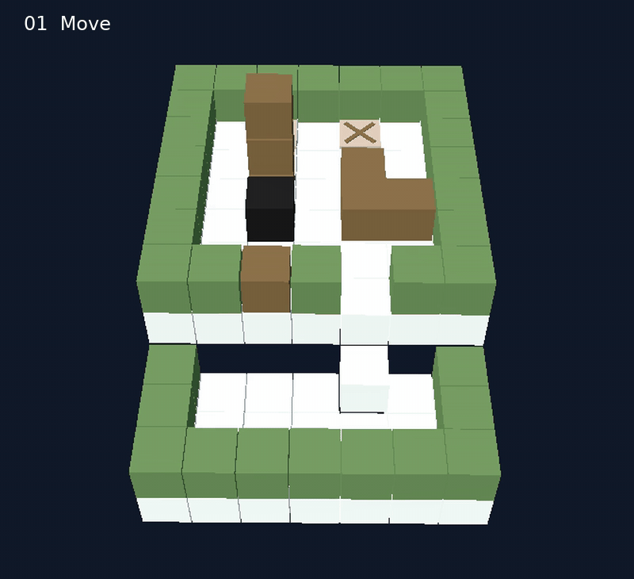
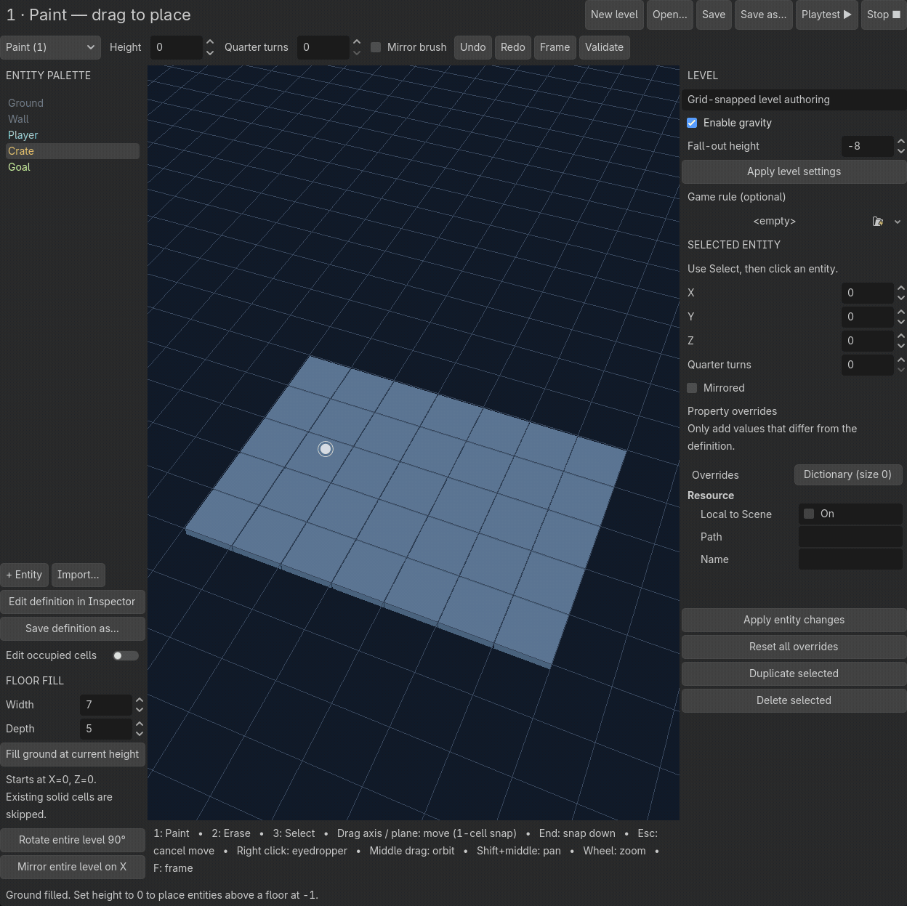
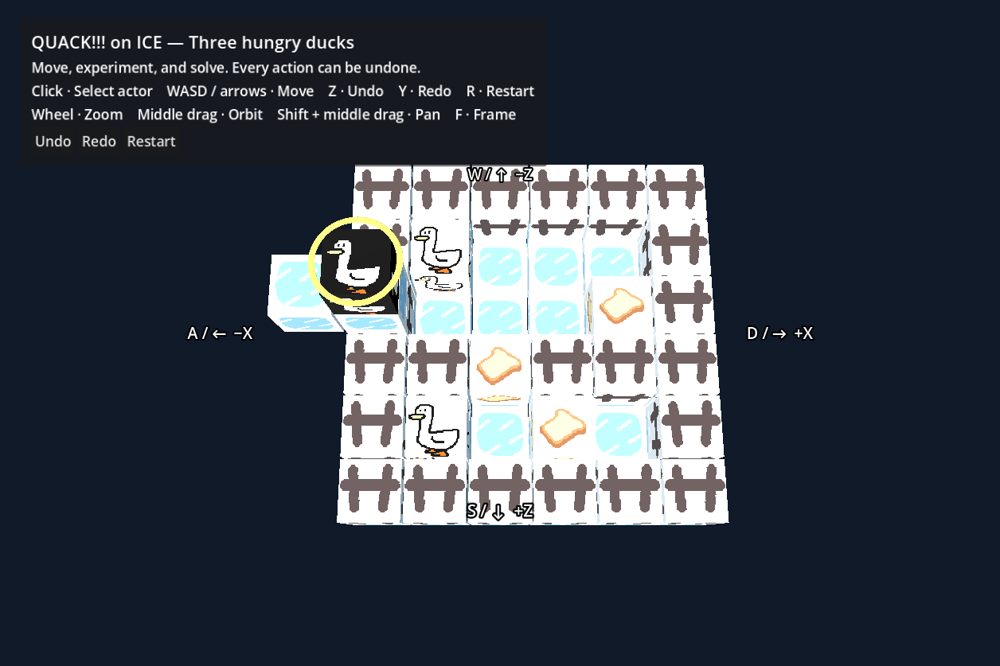

# Grid Game Groundwork for Godot

[English](README.md) | **简体中文**

用于制作 3D 网格解谜游戏的 Godot 插件。通过可视化编辑器绘制关卡、试玩，并用 GDScript 扩展玩法。附带推箱子、管道连接和 QUACK!!! on ICE 示例。

**Godot 4.6+ 标准版 · Compatibility 渲染器 · 已在 4.7.2 验证**

## 快速开始

1. 在 Godot 中导入 `project.godot`。
2. 点击顶部的 **Grid Levels**。若未显示，在 **项目 → 项目设置 → 插件** 中启用 **Grid Game Groundwork**。
3. 点击 **Open…**，打开 `examples/levels/sokoban.tres` 或同目录的 `pipes.tres`／`quack.tres`。
4. 按 **1 / 2 / 3** 切换 Paint 绘制 / Erase 擦除 / Select 选择。在 Select 下拖动 XYZ 箭头或平面手柄可按格移动，按 **End** 向下贴地。
5. 点击 **Save** 保存，再点击 **Playtest ▶** 试玩。

按 **F5** 直接运行推箱子；打开 `examples/pipes.tscn` 后按 **F6** 运行管道示例。推箱子关卡从起点按两次 **S**，可将箱子推落到下层平台。

按 **1**（Paint 绘制）、**2**（Erase 擦除）、**3**（Select 选择）切换工具。拖动绘制或擦除，点击选择实体并查看属性。

在 **Select** 中选中实体后，可拖动 **XYZ 箭头**沿单轴移动，或拖动 **XY／XZ／YZ 平面手柄**在平面内移动。移动时按 **1 格吸附**，多格实体整体移动，右侧坐标同步更新。无效位置标红，松开时恢复原位；**Esc** 取消，一次拖拽可整体撤销／重做。坐标沿用 Godot 约定：**Y 为高度**。

在 **Select** 下，按住 **Shift 点击**可增减选中的实体；Shift 点击空白保持选择，普通点击实体只选它，普通点击空白清空选择。所有选中实体都会高亮，手柄位于最后选中的实体上，移除它后回到上一个选中的实体。

选中实体的实际模型表面以蓝色平滑呼吸高亮，并保留原有纹理。切到 Erase 时保留选择但隐藏蓝色，鼠标指向的实体表面改为红色呼吸，移开即取消；返回 Select 恢复蓝色。非法移动位置使用常亮红色。高亮不穿透遮挡。Select 和 Erase 均按最近可见模型表面精确命中：模型空洞与真正透明的标准材质像素可点穿，占格之外的模型部分也可点中。QUACK 的白色背景仍是不透明、可命中的表面，编辑器选中鸭子不再变黑底。Paint 会吸附鼠标指向的实体占格表面（包括高处顶面和侧面），空白处使用 Height 平面；整笔绘制以落笔时的表面为准，避免鼠标轻微移动就意外叠高。游戏占格规则不变。

拖动手柄会保持相对位置整体移动；任一成员目标非法时整组标红，松开后全部恢复原位，**Esc** 取消整次移动。**Duplicate selected** 将整组向右复制一格，碰撞时统一向上寻找空位，成功后选中新副本；失败不生成副本。**Delete selected** 删除整组。移动、复制、删除每次都只需一次撤销。选择本身不进入撤销历史，撤销删除不会重新选中恢复的实体。

多选时右栏显示选中数量，禁用单实体坐标、旋转、镜像、属性编辑及 **End** 贴地；单选保留原有功能。打开其他关卡或进入形状编辑时清空选择。

### 贴地（End）

1. 按 **3** 切换到 **Select**，点击要移动的实体。
2. 拖动 XYZ 箭头或平面手柄，把实体移到目标位置上方。
3. **保持鼠标左键按下，按 End**：实体会向下贴到最近的地面、箱子或墙顶，X/Z 坐标不变，Y 坐标按整数格对齐。
4. 可以继续拖动；**松开左键**确认整次操作。按 **Esc** 则恢复拖拽前的位置，按 **Ctrl/Cmd+Z** 可整体撤销已经确认的操作。

**不在拖拽时也能贴地**：选中实体后直接按 **End**，立即提交一次可撤销的贴地操作，不需要点击 Apply。多格实体整体移动，任一占用格得到实心支撑就会停下；关卡关闭重力时也可使用。

下方没有实心支撑、当前位置与其他实心实体重叠或位置非法时，按 End 不会改变位置，底部会显示单行提示。已经贴合支撑面时不会产生新的撤销记录。输入文本或坐标时，End 保留输入框自身的行为。

## QUACK!!! on ICE 三维案例

基于 [QUACK!!! on ICE 原游戏（点击游玩）](https://akacmd.itch.io/quack-on-ice)（[原作源码](https://github.com/AkaCMD/Bevy_Jam_4)）制作的独立双层平台解谜案例。控制三只鸭子滑行吃面包，利用上下层落差，并让吃饱的鸭子充当挡块，协助其他鸭子完成目标。

打开 [examples/quack.tscn](examples/quack.tscn) 按 **F6** 运行，或在 **Grid Levels** 中打开 [examples/levels/quack.tres](examples/levels/quack.tres) 编辑、保存和试玩。鼠标点击选鸭，**WASD／方向键**按固定棋盘方向滑行，**Z／Y／R** 撤销、重做和重新开始。完整七步解法见 [QUACK 案例说明](docs/quack-example.md)。

## 功能

- 可视化关卡编辑：绘制、堆叠、形状编辑和 `.tres` 保存。
- 网格移动、多格实体、连锁推动和重力下落。
- 整步撤销与重做，涵盖下落及重新开始。
- 可复用实体定义、单个实体属性覆盖和自定义游戏规则。

## 操作

| 场景 | 输入 | 功能 |
| --- | --- | --- |
| 关卡编辑 | **1 / 2 / 3**（主键盘或小键盘） | Paint 绘制 / Erase 擦除 / Select 选择 |
| 关卡编辑 | 左键点击 / 拖动 | 使用当前工具绘制或擦除；Select 下点击实体查看属性 |
| Select | **Shift+点击** | 增减选中实体；普通点击替换选择，普通点击空白清空选择 |
| Select | 左键拖动 **XYZ 箭头**或 **XY／XZ／YZ 方形手柄** | 沿单轴或平面移动，按整数格吸附 |
| Select，单选或单选拖拽中 | **End** | 向下贴到最近的实心支撑面，之后可继续拖动 |
| 实体拖拽中 | **Esc** | 取消整次拖拽，包括其中的 End 贴地 |
| 关卡编辑 | 右键 | 拾取实体的定义、旋转和镜像作为画笔 |
| 编辑工作区 | **Page Up / Page Down** | 放置平面上升／下降一格，摄像机保持不动 |
| 编辑视口 | **WASD** / **Q / E** | 跟随视角飞行 / 沿世界 Y 轴下降、上升；无需按住鼠标键 |
| 编辑视口 | 右键拖动 | 原地转向；松开后恢复鼠标指针 |
| 编辑视口 | **右键＋滚轮** | 调快 / 调慢飞行速度 |
| 摄像头导航中 | **Esc** | 停止移动并恢复鼠标指针 |
| 形状编辑 | **1 / 2**，左键点击 / 拖动 | 添加 / 移除占用格子；**3** 不生效 |
| 关卡编辑 | **Ctrl/Cmd+S** | 保存关卡 |
| 关卡编辑 | **Ctrl/Cmd+Z** | 撤销上一次编辑操作 |
| 关卡编辑 | **Ctrl/Cmd+Shift+Z** 或 **Ctrl/Cmd+Y** | 重做上一次编辑操作 |
| 编辑视口或试玩 | 中键拖动 | 旋转视角 |
| 编辑视口或试玩 | **Shift+中键拖动** | 平移视角 |
| 编辑视口或试玩 | 滚轮 | 放大 / 缩小 |
| 编辑视口或试玩 | **F** | 将关卡居中显示 |
| 试玩 | **WASD / 方向键** | 按格移动 |
| 试玩 | **Z / Y / R** | 撤销 / 重做 / 重新开始 |
| Godot 编辑器 | **F5**（macOS：**Cmd+B**） | 运行项目 |
| Godot 编辑器 | **F6**（macOS：**Cmd+R**） | 运行当前场景 |
| Godot 编辑器 | **F8**（macOS：**Cmd+.**） | 停止运行项目或场景 |

编辑视口获得焦点后，直接按住 **WASD** 跟随视角连续飞行，**Q/E** 沿世界 Y 轴下降／上升，无需按住右键。右键单击保留吸管，右键拖动用于转向，右键＋滚轮调速（默认每秒 8 格）。摄像头可穿过实体、飞到棋盘下方，并可仰视或俯视。飞行和平移摄像机时，放置平面随高度变化吸附到整数格，Height 和画笔预览同步更新；转向和缩放保持高度。按 **Page Up / Page Down** 可单独升降放置平面，每次一格。松开移动键立即停止；按 **Esc**、切换焦点、打开对话框、窗口失焦或离开编辑界面时停止导航。绘制或拖拽实体结束后才能导航，导航时隐藏画笔预览。形状编辑使用 **2（Erase）＋左键**擦除格子。

**1/2/3** 和 **End** 需要焦点位于 Grid Levels 内，且不能带修饰键；在文本、坐标、Inspector 属性输入框或弹窗中不生效。鼠标绘制或拖拽结束后才能切换工具；**End** 仅在 Select 下只选中一个实体时生效。使用视口快捷键前先点击棋盘，试玩时先点击游戏窗口取得键盘焦点。Godot 的运行／停止键采用[默认编辑器键位](https://docs.godotengine.org/en/4.6/tutorials/editor/default_key_mapping.html)，可在编辑器设置中自定义。

## 用于自己的项目

将 `addons/grid_game_groundwork/` 复制到项目的 `addons/` 目录并启用插件。运行关卡时，为 `Node3D` 挂载 `addons/grid_game_groundwork/runtime/game.gd`，并指定 **Level** 资源。

## 文档

以下详细文档目前为英文。

- [关卡设计指南](docs/designer-guide.md)：制作关卡和配置实体。
- [扩展指南](docs/extending.md)：添加玩法和推动规则。
- [开发说明](docs/development.md)：运行检查和导出构建。
- [领域术语](CONTEXT.md) · [设计决策](docs/adr)

灵感来自 Corey Martin 的 [Grid Game Groundwork for Unity](https://github.com/corey-martin/grid-game-groundwork)。参见[第三方许可声明](THIRD_PARTY_NOTICES.md)。
